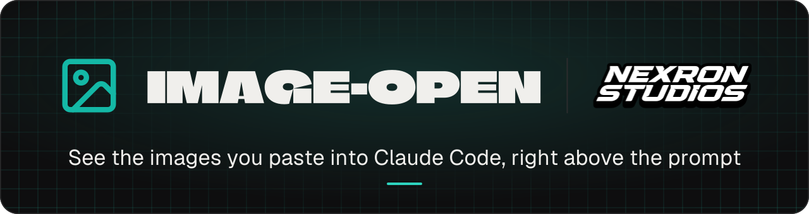
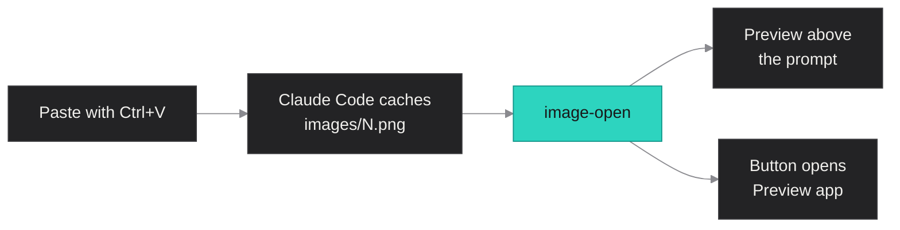

<div align="center">
<picture>
  <source media="(prefers-color-scheme: dark)" srcset="docs/brand/readme-banner-dark.svg">
  <source media="(prefers-color-scheme: light)" srcset="docs/brand/readme-banner-light.svg">
  
</picture>
<br><br>


</div>

When you paste a screenshot into Claude Code, the terminal shows a bare `[Image #1]` and
you have to trust it is the right one. image-open draws a real preview of every pasted
image above the prompt and puts a button under it that opens the image full size.

| | |
| --- | --- |
| 🖼️ **Preview** | A sharp thumbnail of each pasted image above the prompt, before you send. |
| 🔍 **Open full size** | One click on `Bild N öffnen` opens the image in Preview on macOS or Photos on Windows. |
| 🧩 **Works in herdr** | Real pictures inside the herdr multiplexer when it runs in Ghostty. |

## How it works



The mod polls the prompt draft for `[Image #N]` tags, finds each paste in Claude Code's
session cache, downscales it once with `sips` and draws it with Claude Code's `Image`
element. The button hands the original file to the system viewer. On Windows, PowerShell
does both jobs (`System.Drawing` to downscale, `Start-Process` to open).

## Install

Inside Claude Code:

```
/plugin marketplace add nexron-studios/NEXRON-image-open
/plugin install image-open@claude-image-open
/reload-plugins
```

## Real pictures or none

The preview is a real picture only in terminals that speak the kitty graphics protocol:
Ghostty, kitty or WezTerm. That also holds inside the herdr multiplexer, but herdr does
not identify itself as such a terminal, so Claude Code has to be told to draw pictures
anyway. Add this to the `env` block of `~/.claude/settings.json` and start a new session:

```json
"env": { "CLAUDE_CODE_FORCE_TERMINAL_IMAGES": "1" }
```

Do not set it in iTerm2, Terminal.app or Windows Terminal: they cannot draw these pictures
and show garbage instead. Without the setting, the mod leaves the preview out in terminals
it does not recognise, and the button still opens the image.

On Windows there is no Ghostty, so expect the button without a preview. Whether WezTerm
draws the pictures with the setting above is untested.

## Stack

- TypeScript hooks module against the Claude Code mod API (`hooks/register.tsx`, `hooks/preview.ts`)
- macOS: `sips` to downscale, `open` for the full-size view
- Windows: PowerShell with `System.Drawing` to downscale, `Start-Process` for the full-size view
- Edit, then `claude plugin marketplace update claude-image-open` and
  `claude plugin update image-open@claude-image-open`, and start a new session

<div align="center"><sub>image-open is a NEXRON Studios tool. Banner from docs/brand/banner.json.</sub></div>
